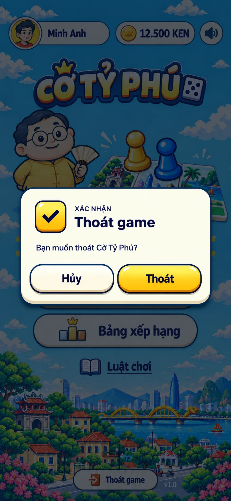
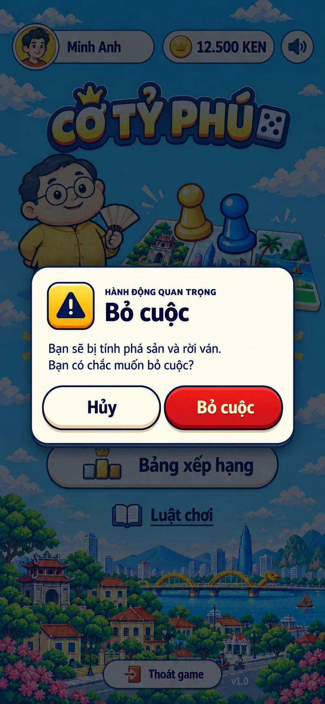
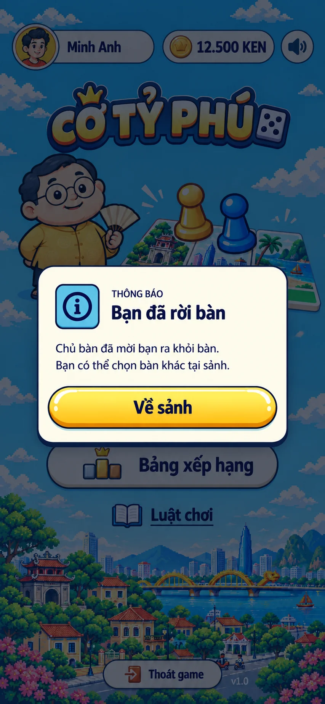
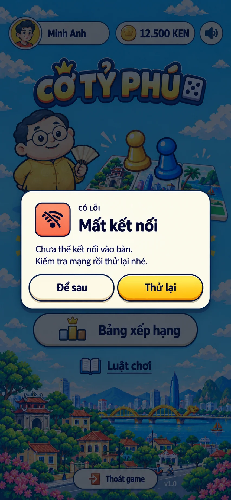

# O5. Modal xác nhận và thông báo

Đặc tả lớp phủ **O5** của Cờ Tỷ Phú: một khung modal dùng chung cho hai loại, **xác nhận** (hỏi trước khi làm) và **thông báo** (báo tin cần người chơi đọc). Hành vi tổng quát theo [02 §O5](../../02-screen-specs.md#o5-confirmmodal), cấu trúc chung theo [03 §12](../../03-component-specs.md#12-modal-s4-s9-o3-o5), token theo [01-foundations](../../style/01-foundations.md). Style dưới đây theo code đang chạy và tông màu lobby S2; bốn ảnh ví dụ được lưu bên dưới để tham khảo, chưa thay thế đặc tả hoặc xác nhận hoàn tất UI.

## Ảnh ví dụ

Lưu theo yêu cầu người dùng ngày **21/10/2026**. Công cụ: built-in imagegen; ảnh gốc PNG 853 × 1844 được chuyển sang WebP chất lượng 85, giữ nguyên kích thước, không chỉnh sửa nội dung. Nguồn và trạng thái ghi tại [asset generation log](../../asset-generation-log.md#o5-modal--bốn-ảnh-ví-dụ).

| Xác nhận thường — Thoát game | Xác nhận nguy hiểm — Bỏ cuộc |
|---|---|
| [](./examples/01-confirm.webp) | [](./examples/02-danger.webp) |
| **Thông báo một nút — Bạn đã rời bàn** | **Lỗi kết nối — Mất kết nối** |
| [](./examples/03-notice.webp) | [](./examples/04-error.webp) |

Các ảnh dùng chung nền lobby để so sánh khung; tình huống Bỏ cuộc thực tế nằm trên bàn chơi. Đây là **example tham khảo**, chưa phải concept chuẩn đã duyệt. Kích thước khung, badge và sắc độ trong ảnh AI còn sai khác; khi dựng dùng token và số đo trong docs, chữ DOM và hệ icon của game. Không import nguyên ảnh vào runtime. Việc lưu ảnh không đánh dấu hoàn thành checklist triển khai.

## Bản dựng CSS

**Thân nút, focus và khung modal dựng bằng CSS; SVG chỉ dành cho icon.** [button.css](./svg/button.css) chứa state chung của nút (hover, bấm, disabled, pending, `:focus-visible` một vòng navy 2px cách 3px, reduced motion, forced colors). [9 icon SVG](./svg/icons/) giữ nguyên nét từ `assets/icons`, bổ sung `ic-info` và `ic-spinner`. Bộ này **chưa import vào game**; checklist runtime bên dưới vẫn giữ trạng thái thực tế.

## 1. Khi nào dùng modal

| Cần báo | Dùng | Lý do |
|---|---|---|
| Hành động khó hoàn tác (bỏ cuộc, về sảnh giữa ván, phá sản, hạ cấp Khách sạn) | **Modal xác nhận** | Phải dừng lại và chọn |
| Tin quan trọng người chơi phải đọc (lỗi không tự khắc phục, kết quả cần biết, tính năng bị khóa) | **Modal thông báo** | Chặn thao tác đến khi bấm nút |
| Tin ngắn, không cần làm gì (hết giờ hệ thống đi thay, thao tác không hợp lệ, tính năng đang làm) | Toast (O6) | Tự tắt, không chặn ván |
| Trạng thái kéo dài (đối thủ mất kết nối) | Banner (O4) | Hiện suốt thời gian xảy ra |
| Loading/lỗi lần vào sảnh đầu | S1 | Có bố cục riêng |

Không dùng modal cho tin mà người chơi không cần phản hồi. Mỗi thời điểm chỉ một modal O5; tin đến sau xếp hàng đợi, không chồng hai hộp.

## 2. Hiện trạng code

- [`NoticeModal.tsx`](../../../components/NoticeModal.tsx) là component O5 chung, render theo `kind`/`tone` (§8), mở bằng `showNotice(...)` trong store, render tại `App.tsx`. Đang dùng cho `Về sảnh`, `Bỏ cuộc` (bàn chơi) và xác nhận phá sản (`DebtModal`).
- Khung chung: [`ModalHeading.tsx`](../../../components/ModalHeading.tsx) (ô biểu tượng + dòng nhỏ + tiêu đề), [`useDialogFocus.ts`](../../../components/useDialogFocus.ts) (giữ focus, `Escape`, trả focus), CSS `.ty-backdrop`, `.ty-modal*`, `.ty-btn*` trong `style.css`. `BotSetupModal`, `RulesModal`, `DebtModal` dùng lại khung này.
- **Chưa có:** `Thoát game` ở sảnh đang thoát ngay, không hỏi lại; chưa đóng modal xác nhận khi hết giờ lượt.

## 3. Cấu trúc

```
┌ backdrop (phủ toàn màn, overlay tối) ─────────┐
│   ┌ hộp 340 ──────────────────────────────┐   │
│   │ [ô biểu tượng]  DÒNG NHỎ VIẾT HOA     │   │
│   │                 Tiêu đề               │   │
│   │ Nội dung 1–3 dòng                     │   │
│   │ Gợi ý phụ (tuỳ chọn)                  │   │
│   │ [ Nút phụ ]        [ Nút chính ]      │   │
│   └───────────────────────────────────────┘   │
└───────────────────────────────────────────────┘
```

| Phần | Thông số (mốc 390 × 844) |
|---|---|
| Backdrop | `position: fixed`, phủ toàn màn, `--ty-overlay`; padding 16; z `--ty-z-modal` (50); hiện dần 150 ms |
| Hộp | rộng `min(100%, 340px)`, cao tối đa `100vh − 32`, cuộn trong hộp khi dài; nền `--ty-paper`, chữ navy, viền navy 2, bo góc **22**, padding 18, khoảng cách các khối 14; bóng `0 6px 0 --ty-ink` + `--ty-sh-lg`; hiện bằng phóng 0,92 → 1 trong 200 ms |
| Ô biểu tượng | 42 × 42, bo 12, viền navy 2, bóng `0 2px 0 --ty-ink`, icon `ic-*` 22; màu nền theo tông (§4) |
| Dòng nhỏ | 12 / 800, viết hoa, giãn chữ 0,08em, độ mờ 60% |
| Tiêu đề | 21 / 800, một dòng nếu được; là `aria-labelledby` của hộp |
| Nội dung | 15 / 400, line-height 1,45; là `aria-describedby` |
| Gợi ý phụ | 13 / 400, line-height 1,4, độ mờ 75% |
| Hàng nút | flex, gap 10, đệm dưới 4; các nút chia đều chiều rộng, cao tối thiểu 48 (vùng chạm ≥ 44) |

Màn 360 px: hộp vẫn rộng tối đa trừ padding 16 hai bên; nhãn nút không cắt chữ, quá dài thì xuống dòng trong nút. Màn thấp: hộp cuộn bên trong, hàng nút luôn nằm trong hộp.

## 4. Loại và tông

| Loại | Tông | Ô biểu tượng | Icon | Dòng nhỏ | Nút chính | Nút phụ |
|---|---|---|---|---|---|---|
| Xác nhận | thường | gradient gold-light → gold | `check` | `XÁC NHẬN` | `.ty-btn-gold` | `Hủy` `.ty-btn-paper` |
| Xác nhận | nguy hiểm | gradient gold-light → gold | `warning` | `HÀNH ĐỘNG QUAN TRỌNG` | `.ty-btn-danger` | `Hủy` `.ty-btn-paper` |
| Thông báo | thông tin | `--ty-sky` | `ic-info` (cần thêm) | `THÔNG BÁO` | `.ty-btn-gold` | không có hoặc nút phụ paper |
| Thông báo | thành công | `--ty-jade-light` | `check` | `THÀNH CÔNG` | `.ty-btn-gold` | không có |
| Thông báo | cảnh báo | gradient gold-light → gold | `warning` | `LƯU Ý` | `.ty-btn-gold` | tuỳ chọn |
| Thông báo | lỗi | `--ty-coral-light` | `warning`, hoặc `wifi-off` khi lỗi mạng | `CÓ LỖI` | `.ty-btn-gold` (`Thử lại`) | tuỳ chọn `Để sau` |

- Icon trong ô biểu tượng luôn navy; nền sky/jade/coral đủ tương phản với icon navy, không dùng chữ trắng trên ô.
- Được thay icon theo ngữ cảnh khi rõ nghĩa hơn: `lock` (tính năng khóa), `ken`/`coins` (tiền), `wifi-off` (mạng), `flag` (bỏ cuộc).
- Thông báo một nút: nút chính rộng hết hàng. Hai nút: nút phụ trái, nút chính phải.
- Chỉ đỏ (`.ty-btn-danger`) cho hành động mất tiến trình/tài sản; lỗi chỉ đổi màu ô biểu tượng, nút vẫn vàng.

## 5. Hành vi

| | Xác nhận | Thông báo |
|---|---|---|
| Mở | gọi từ store; một modal tại một thời điểm | như xác nhận; tin sau xếp hàng đợi |
| Focus ban đầu | nút chính; riêng tông nguy hiểm focus `Hủy` | nút chính |
| `Escape` | = `Hủy` | = nút đóng; thông báo bắt buộc (`dismissible: false`) bỏ qua |
| Bấm nền tối | = `Hủy` | = nút đóng; thông báo bắt buộc bỏ qua |
| Sau khi đóng | trả focus về nút đã mở modal | như xác nhận |
| Tự đóng theo giờ | không | không (đó là việc của toast) |

- Giữ focus trong hộp (Tab/Shift+Tab vòng trong hộp); phần dưới bị `aria-hidden` khi modal mở, như `useDialogFocus` đang làm.
- Nút chính chạy hành động rồi đóng modal; hành động bất đồng bộ thì nút chuyển trạng thái đang xử lý và khóa bấm lại, không đóng hộp đến khi xong hoặc lỗi.
- Đang trong ván: modal không dừng đồng hồ lượt; nếu hết giờ trong lúc mở, đóng modal xác nhận (lựa chọn không còn hiệu lực) và báo bằng toast.
- Reduced motion: bỏ hiệu ứng phóng/hiện dần, hộp hiện ngay.

## 6. Nội dung chữ

- Tiêu đề ngắn, nói việc sắp xảy ra hoặc tin chính: `Bỏ cuộc`, `Về sảnh`, `Mất kết nối`. Không dùng `Thông báo` làm tiêu đề (đã có ở dòng nhỏ).
- Nội dung tối đa 3 dòng ở 360 px; nói hậu quả cụ thể: `Bạn sẽ bị tính phá sản và xếp cuối. Kết thúc ván ngay?`
- Nhãn nút là động từ trùng tiêu đề (`Bỏ cuộc`, `Về sảnh`, `Thử lại`, `Đã hiểu`); không dùng `OK`, `Có`, `Không`. Nút hủy là `Hủy`.
- Nhắc người chơi khác thì ghi `@username` kèm icon VIP theo [03 §18](../../03-component-specs.md#18-tên-người-chơi-và-icon-vip-playername-playeravatar).
- Tiền ghi theo `formatMoney`/`formatKen` như phần còn lại của game.

## 7. Truy cập

- `role="dialog"` + `aria-modal="true"`; tông nguy hiểm và lỗi dùng `role="alertdialog"` để trình đọc màn hình đọc ngay.
- `aria-labelledby` trỏ tiêu đề, `aria-describedby` trỏ nội dung.
- Focus ring navy 2 px như toàn game; chữ trên nền paper đạt tương phản AA.

## 8. API

`NoticeState` trong [`store/useTycoon.ts`](../../../store/useTycoon.ts):

```ts
interface NoticeState {
  kind: 'confirm' | 'notice';
  tone?: 'default' | 'danger' | 'info' | 'success' | 'warning' | 'error';
  title: string;
  body: string;
  hint?: string;
  icon?: TyIconName;
  okLabel: string;
  cancelLabel?: string;
  dismissible?: boolean;
  onOk?: () => void | Promise<void>;
  onCancel?: () => void;
}
```

- `showNotice(notice)` mở ngay nếu chưa có modal, nếu đang có thì xếp vào `noticeQueue`. `closeNotice(notice)` chỉ đóng đúng tin đang hiện rồi lấy tin tiếp theo.
- Mặc định: `tone` là `default` với xác nhận, `info` với thông báo; `cancelLabel` là `Hủy` với xác nhận, không có với thông báo; dòng nhỏ và icon theo bảng §4, `icon` để đổi icon theo ngữ cảnh.
- Modal tự đóng sau `onOk`/`onCancel`, caller không cần tự đóng. `onOk` trả Promise thì nút chính `aria-busy` có spinner, khóa nút phụ, `Escape` và bấm nền; Promise lỗi thì mở khóa và giữ hộp để thử lại.

```ts
showNotice({ kind: 'confirm', tone: 'danger', title: 'Bỏ cuộc', body: '…', okLabel: 'Bỏ cuộc', onOk: forfeit });
showNotice({ kind: 'notice', tone: 'error', icon: 'wifi-off', title: 'Mất kết nối', body: '…', okLabel: 'Thử lại', cancelLabel: 'Để sau', onOk: reconnect });
```

## 9. Tình huống dùng

| Tình huống | Loại / tông | Tiêu đề | Nút |
|---|---|---|---|
| Về sảnh giữa ván | xác nhận / nguy hiểm | `Về sảnh` | `Hủy` · `Về sảnh` |
| Bỏ cuộc | xác nhận / nguy hiểm | `Bỏ cuộc` | `Hủy` · `Bỏ cuộc` |
| Phá sản khi không đủ trả nợ | xác nhận / nguy hiểm | `Phá sản` | `Hủy` · `Phá sản` |
| Hạ cấp Khách sạn xuống Biệt thự | xác nhận / thường | `Hạ cấp` | `Hủy` · `Hạ cấp` |
| Thoát game từ sảnh | xác nhận / thường | `Thoát game` | `Hủy` · `Thoát` |
| Mất kết nối khi vào bàn | thông báo / lỗi, icon `wifi-off` | `Mất kết nối` | `Để sau` · `Thử lại` |
| Không đủ KEN vào bàn xếp hạng | thông báo / cảnh báo, icon `ken` | `Chưa đủ KEN` | `Đã hiểu` |
| Bị mời ra khỏi bàn | thông báo / thông tin | `Bạn đã rời bàn` | `Về sảnh` |

## 10. Checklist triển khai

- [x] Modal xác nhận thường và nguy hiểm, giữ focus, `Escape`, bấm nền để hủy.
- [x] Modal thông báo một nút và hai nút; tông thông tin/thành công/cảnh báo/lỗi.
- [x] Thêm `ic-info` vào hệ icon ([06](../../06-icon-system.md)).
- [x] `role="alertdialog"` cho tông nguy hiểm/lỗi; tùy chọn `dismissible: false`.
- [x] Hàng đợi thông báo; nút chính có trạng thái đang xử lý cho hành động bất đồng bộ.
- [x] Focus trong modal: một vòng navy 2 px cách 3 px, bỏ bóng nổi của nút khi focus.
- [ ] Xác nhận `Thoát game` ở sảnh.
- [ ] Đóng modal xác nhận khi hết giờ lượt (§5).
- [x] Chụp 390 × 844 và 360 × 640 cho từng loại/tông.
- [ ] Kiểm phóng chữ 200%.
