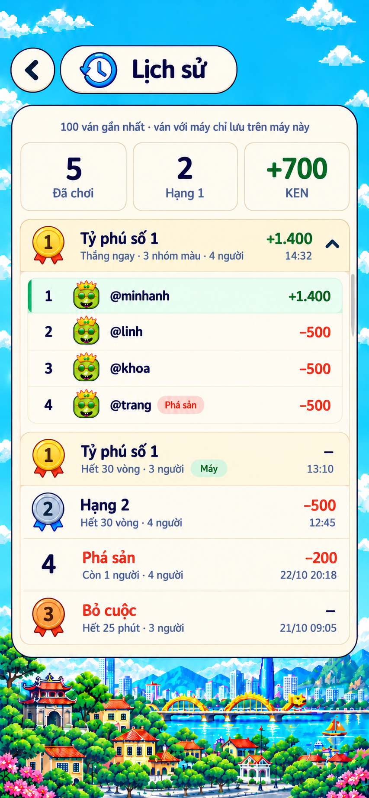

# S10 — Lịch sử · Mint tối giản

**Người dùng chọn mẫu 02 ngày 23/10/2026.** Hành vi và dữ liệu theo [02 §S10](../../02-screen-specs.md#s10-lịch-sử), server theo [05 §9.2](../../05-gameplay-rules-and-protocol.md#92-lịch-sử-ván). **Đã dựng UI ngày 23/10/2026** (`screens/HistoryScreen.tsx`), ván online dùng dữ liệu giả, ván máy lưu thật; chụp đối chiếu 390 × 844 và 360 × 640. Chưa sửa server.

Ảnh 853 × 1844 được giữ nguyên byte. Prompt đầy đủ, nguồn sinh, SHA-256 và danh sách asset dùng lại ở [manifest](./manifest.json). Hai mẫu không chọn, trang so sánh và bản nháp trùng đã được dọn.

## Hướng đã chốt

- Cùng họ với [S11 Mint](../s11-leaderboard/README.md): trời/phố pixel, UI và chữ mượt, header pill kem và nút quay lại tròn.
- Panel kem sáng, viền navy mảnh, cạnh beige nhẹ. Ba ô thống kê là số liệu, không phải tab.
- Một danh sách chung ván online/máy, mỗi hàng hai dòng; kết quả/lý do ở giữa, KEN và thời gian căn phải. Hạng 1 nền vàng nhạt; chip Máy mint.
- Bấm hàng mở chi tiết ngay bên dưới, mỗi lúc một ván. Hàng của mình mint với vạch jade, vẫn ghi `@username`; Phá sản/Bỏ cuộc coral.

## Phân lớp asset — không cần cắt thêm ảnh

Đã đối chiếu concept với thư viện hiện có. Toàn bộ minh họa có thể dùng lại; không tạo bản PNG/WebP trùng hoặc bộ asset riêng cho S10.

| Chi tiết | Nguồn / cách dựng |
|---|---|
| Đồng hồ header và trạng thái trống | [ill-history.webp](../../../assets/lobby/ill-history.webp), PNG nguồn [icon-history.png](../../../assets/screens/lobby/icon-history.png) |
| Nền trời/phố | [bg-board-pixel.webp](../../../assets/lobby/bg-board-pixel.webp), cùng S11; canh cảnh theo viewport bằng CSS |
| Huy chương hạng 1–3 | [Bộ S11](../../../assets/leaderboard/README.md): [vàng](../../../assets/leaderboard/medal-gold.webp), [bạc](../../../assets/leaderboard/medal-silver.webp), [đồng](../../../assets/leaderboard/medal-bronze.webp); mặt trống, số DOM; S10 rộng 32 |
| Quay lại và mũi tên mở/thu chi tiết | [chevron-left.svg](../../../assets/room-list/chevron-left.svg); quay lại giữ nguyên, xoay +90° thành lên / −90° thành xuống; không cần thêm SVG |
| Avatar người chơi/bot | `avatarIconUrl(vipType)` từ [helper hiện có](../../../helpers/player.ts); lấy VIP thật và fallback Ola, không cắt avatar AI |
| Nút quay lại và header pill | CSS paper, viền navy, cạnh beige nhẹ |
| Panel chính và ba ô tóm tắt | CSS cream/paper, bo góc và viền mảnh; chữ/số ghép DOM |
| Khung danh sách, hàng thắng, chi tiết mở | CSS giấy kem, vàng nhạt `#fff6dc`, divider beige; không chụp cả bảng thành ảnh |
| Hàng mình, chip Máy, nhãn ra khỏi ván | CSS mint + vạch jade, pill mint/coral; nhãn là DOM |
| Thanh cuộn | CSS/native track và thumb; không cắt thanh cuộn từ concept |
| Đang tải / lỗi / offline | Skeleton và banner CSS; `TyIcon` có sẵn `warning`, `wifi-off`, `refresh` |
| CTA Chơi với máy khi trống | Surface mint CSS theo nút sảnh, [ill-bot.webp](../../../assets/lobby/ill-bot.webp) nếu dùng icon; nhãn DOM |
| Font | Nunito Latin + Vietnamese đang dùng trong `tycoon/style.css` |

Đồng hồ và ba huy chương có alpha; huy chương không có số cố định. Asset dùng chung được giữ nguyên tại đường dẫn hiện có. Nền phố, shading của huy chương và nét avatar có khác ảnh AI; dùng bộ chuẩn của game để đồng bộ S2/S11, không coi là cắt trùng từng pixel từ S10.

## Kích thước và dữ liệu

Mốc 390 × 844 đo theo ảnh này (chi tiết ở 02 §S10): header cách đỉnh 50 + safe-area, quay lại 46, tiêu đề 24/800; panel radius 26, viền 1,5, cao tối đa 584. Ba ô tóm tắt cao 72, số 29/800; mỗi hàng ván 56; dòng chi tiết 38, avatar 28. Danh sách cuộn; màn 360 × 640 giữ cỡ chữ, lý do dài ellipsis.

Runtime dựng theo đúng số đo ảnh; đặt chồng ảnh chụp 390 × 844 lên concept thì khung, ô tóm tắt, hàng và phần chi tiết trùng vị trí, 5 ván vừa khít như ảnh. Khác ảnh: avatar là VIP thật của từng người, ngày giờ dạng `22/10 20:18` theo đồng hồ máy.

Ảnh dùng dữ liệu giả: 5 ván, 2 lần hạng 1, tổng **+700 KEN**. Ván đầu bốn người cược 500 có trả thưởng 1.900 sau phí, nên net **+1.400**; ba người còn lại mỗi người −500. Các ván khác −500, −200 hoặc `—`; tổng online là 1.400 − 500 − 200 = +700. Ván máy tính vào số ván/hạng 1, không cộng KEN/EXP/BXH. “100 ván gần nhất” là giới hạn danh sách, không phải số ván hiện có.

Tải/trống/lỗi/offline, lưu lịch sử máy, bàn phím và trợ năng giữ theo 02 §S10. Chữ, tên, số hạng, tiền và thời gian luôn là dữ liệu DOM.
