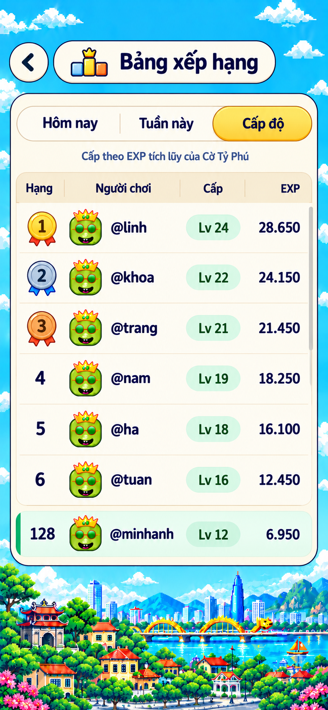

# S11 — Bảng xếp hạng · Mint tối giản

**Người dùng đã chọn mẫu 02 ngày 23/10/2026.** Đây là ảnh chuẩn và style của S11. Hành vi, thống kê, trường hợp trống/lỗi/loading và dữ liệu theo [02 §S11](../../02-screen-specs.md#s11-bảng-xếp-hạng), [05 §9.1](../../05-gameplay-rules-and-protocol.md#91-bảng-xếp-hạng-và-cấp-độ). **Đã dựng UI ngày 23/10/2026** (`screens/LeaderboardScreen.tsx`, dữ liệu giả `helpers/leaderboardMock.ts`), chụp đối chiếu 390 × 844 và 360 × 640; chưa nối server.

Ảnh 853 × 1844, giữ nguyên PNG đã chọn. Minh họa tab Cấp độ sau khi người dùng chuyển tab; khi mở màn mặc định vẫn là Hôm nay. Số, tên, avatar và thứ tự trong ảnh là mẫu. Hai style không chọn, bản hai tab cũ và trang so sánh đã được dọn.

## Hướng đã chốt

- Nền trời/phố pixel; UI và chữ mượt. Header rời gồm nút quay lại tròn và pill kem chứa icon BXH + tiêu đề.
- Một panel kem sáng bao trọn thanh ba tab, dòng giải thích, bảng và hàng ghim. Viền navy mảnh, cạnh beige nhẹ; không dùng khung navy/gold dày của mẫu 03.
- Tab gold nổi nhẹ, hai tab còn lại paper; nhãn cột có nền sand nhạt, các hàng chia bằng đường beige mảnh.
- Tab Cấp độ dùng chip mint `Lv n`, EXP navy. Hàng mình mint nhạt + vạch jade, giữ `@username`; nếu ngoài top 100 thì ghim ở đáy panel như ảnh.
- Huy chương 1/2/3 có màu vàng/bạc/đồng và đuôi ruy băng đỏ/xanh/đỏ cam. Số hạng là chữ UI ghép trên mặt trống.

## Bố cục và dữ liệu

Mốc 390 × 844, rộng 360–520: padding ngoài 12; header 46, nút quay lại có vùng chạm 44; panel rộng `100% − 24`, radius khoảng 24–28, padding trong 12. Thanh tab cao 44, khoảng hở quanh subtitle 10–12. Tiêu đề cột khoảng 40, mỗi hàng khoảng 56; avatar VIP 36, tên 15/700, số 15/800 `tabular-nums`. Huy chương dùng hộp tối đa 36 × 44, giữ tỷ lệ artwork.

Giữ header/tab/nhãn cột nhìn thấy, chỉ thân bảng cuộn; hàng mình ngoài top 100 ghim dưới thân cuộn. Cảnh phố co trước trên màn thấp. Không cố ép toàn bộ top 100 vào viewport. Cột theo 02 §S11 (tab thắng `48 / 1fr / 52 / 48`, Cấp độ `50 / 1fr / 78 / 66`, thu nhỏ ở màn ≤ 370; hàng 59, avatar 38, tên 16/800 theo đo ảnh; thanh cuộn mảnh tự dựng luôn hiện); số căn phải, tên dài ellipsis. Thu icon header trước khi thu chữ.

| Tab | Cột | Dòng phụ |
|---|---|---|
| Hôm nay | Hạng · Người chơi · Thắng · Trận | Thắng = về hạng 1 |
| Tuần này | Hạng · Người chơi · Thắng · Trận | Thắng = về hạng 1 · từ thứ Hai |
| Cấp độ | Hạng · Người chơi · Cấp · EXP | Cấp theo EXP tích lũy của Cờ Tỷ Phú |

Hai tab thắng có chip `Lv n` nhỏ dưới tên; Cấp độ dùng chip ở cột Cấp như ảnh. EXP định dạng `vi-VN`, cấp theo công thức trong [progression.ts](../../../../src/sdk/progression.ts). Avatar lấy bằng `avatarIconUrl(vipType)`, không cắt từ concept. Cột EXP, số hạng và số thống kê đều DOM; thứ tự từ server. Các trường hợp `me` thiếu, API chưa hỗ trợ level, cache 60 giây, mất kết nối và accessibility theo 02, không thay đổi trong lần chốt style.

## Phân lớp asset

| Chi tiết | Nguồn / cách dựng |
|---|---|
| Ba huy chương | [Bộ asset S11](../../../assets/leaderboard/README.md); mặt trống có alpha, số 1/2/3 ghép bằng DOM |
| Icon BXH ở header/trống | [ill-leaderboard.webp](../../../assets/lobby/ill-leaderboard.webp), dùng lại, không sinh bản trùng |
| Nút quay lại | [chevron-left.svg](../../../assets/room-list/chevron-left.svg); mặt nút tròn paper dựng CSS |
| Nền trời/phố | [bg-board-pixel.webp](../../../assets/lobby/bg-board-pixel.webp), canh vị trí bằng CSS theo viewport |
| Avatar | `avatarIconUrl(vipType)` / mặt Ola mặc định, theo 03 §18 |
| Header và panel kem | CSS paper, viền navy mảnh, cạnh beige; chiều rộng co giãn |
| Thanh tab | CSS segmented paper; gold active, phân cách beige, highlight nhẹ; text và trạng thái là DOM |
| Header cột / divider hàng | CSS sand nhạt / đường beige 1 px |
| Chip Lv | CSS mint nhạt, radius pill, chữ xanh đậm; không chụp cả nhãn từ ảnh |
| Hàng mình | CSS mint nhạt + vạch jade trái; giữ trong panel, không tách thành ảnh |
| Thanh cuộn | CSS/native scrollbar, màu track beige nhạt/thumb xám |
| Trạng thái tải/lỗi | Skeleton CSS; icon warning/refresh sẵn có; text từ 02 |
| Font | Nunito local hiện có, không lấy chữ AI làm asset |

Không dùng screenshot làm background của UI. Mọi decor nhìn thấy đã có lớp ở bảng trên; không cần xuất thêm ảnh khung, tab hoặc ô nhập liệu cho màn này.

## Nguồn và đối chiếu

Concept: built-in `image_gen`, output `exec-c81e15cd-9aba-4df8-91a9-7882f397730a.png`. Prompt đầy đủ và hash ảnh chốt lưu trong [manifest nguồn](../../../assets/screens/leaderboard/manifest.json), cùng prompt và nguồn sinh từng huy chương. Quy cách dùng, đối chiếu và giới hạn asset ở [README asset](../../../assets/leaderboard/README.md).

Đây là concept đã chốt, chưa phải bằng chứng đạt visual QA của toàn màn runtime. Các giá trị CSS là mốc triển khai; cần so ảnh chụp thật ở 390 và 360 khi dựng màn.
