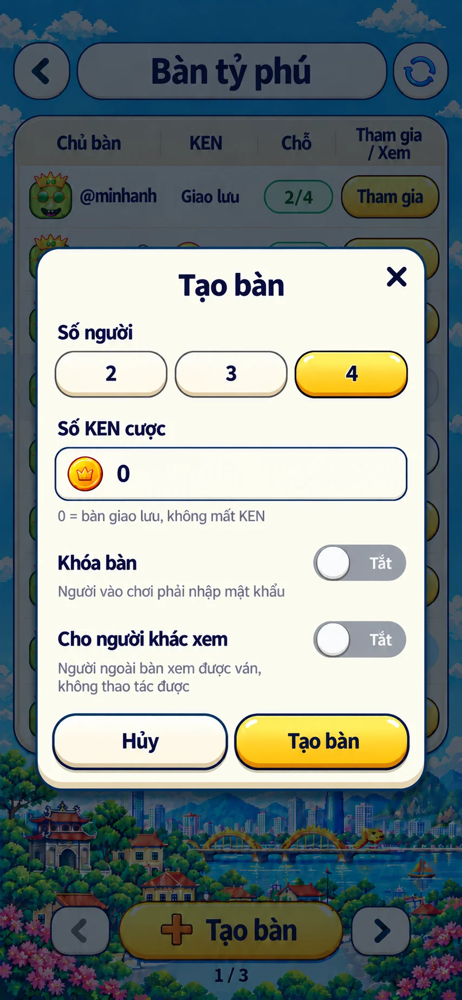
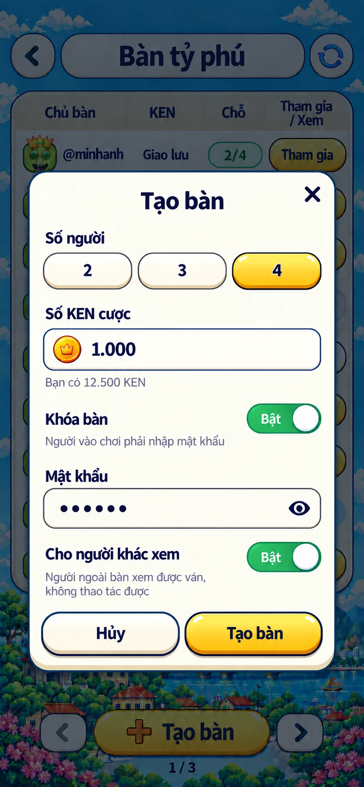
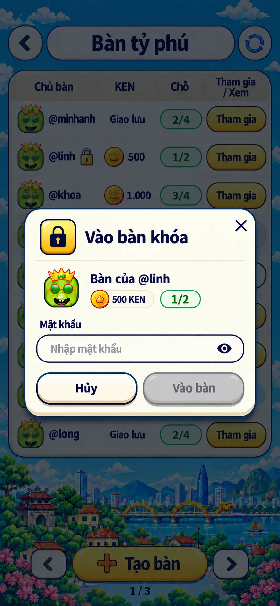
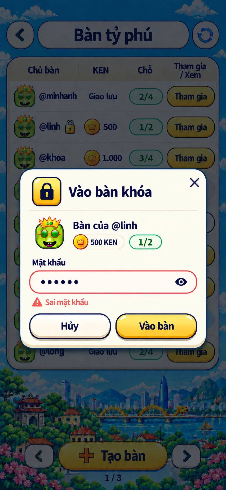
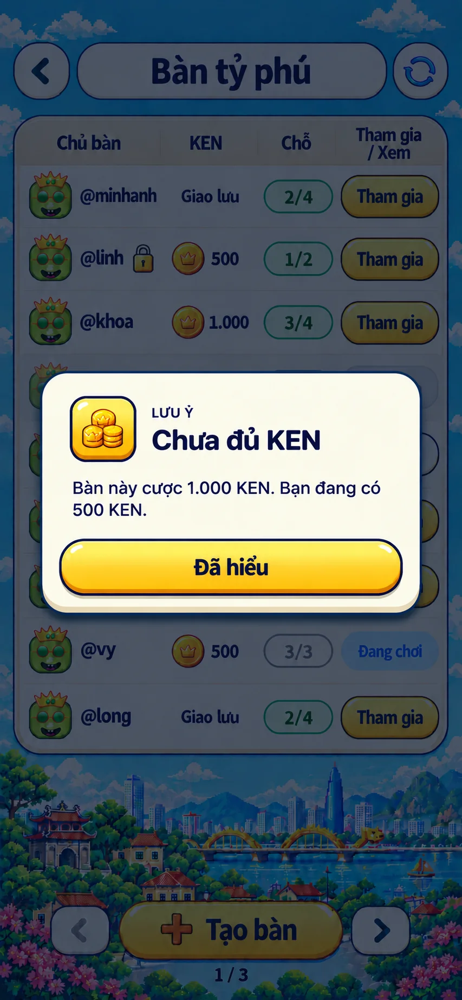
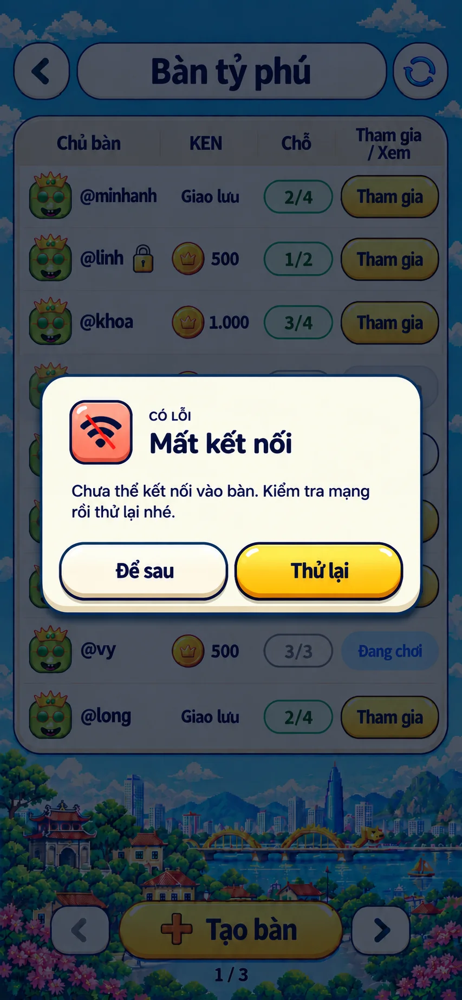

# S3. Danh sách bàn — Bảng giấy kem

**Đã chọn mẫu 01 — Bảng giấy kem** (22/10/2026). Đây là đặc tả style để dựng màn danh sách bàn online theo ảnh bên dưới. Hành vi và dữ liệu theo [02 §S3](../../02-screen-specs.md#s3-danh-sách-bàn-rankedscreen); cột KEN và nút `Xem` theo [11 §1.3](../../11-room-settings.md#13-hiển-thị) và [11 §2.4](../../11-room-settings.md#24-nút-vào-xem-ở-s3). UI đã dựng với **dữ liệu giả** ngày 22/10/2026, chưa nối server; cách xem và kịch bản giả ở [§10](#10-bản-dựng-dữ-liệu-giả).

Ảnh **853 × 1844 px**, giữ style mẫu 01; header đã sửa theo yêu cầu ngày 22/10: reload chỉ có icon và tách khỏi pill tiêu đề. [Log nguồn và prompt](../../asset-generation-log.md#s3-danh-sách-bàn--bảng-giấy-kem). Ảnh concept không import vào game; chữ, số và avatar luôn là DOM hoặc asset gốc.

## 1. Hướng hình ảnh

- Nền trời cyan có mây pixel, dải phố Việt Nam (Văn Miếu, cầu Rồng, tòa tháp, hoa đào) ở phần dưới, giống hệt lobby S2. Danh sách nằm trong **một bảng giấy kem duy nhất**, viền navy, chia hàng bằng đường kẻ mảnh; không tách mỗi bàn thành thẻ riêng.
- Header gồm ba khối: nút tròn `‹` bên trái, thanh pill kem chứa tiêu đề `Bàn tỷ phú` ở giữa, nút tròn `Làm mới` chỉ có icon bên phải, đối xứng với nút `‹`.
- Footer: nút vàng `+ Tạo bàn` ở giữa, hai nút phân trang tròn hai bên, số trang `1 / 3` bên dưới.
- Một nút vàng nổi bật nhất là `Tạo bàn`; các nút `Tham gia` cũng vàng nhưng nhỏ, nằm trong bảng. `Xem` là nút kem viền navy.
- Pixel chỉ dùng cho phong cảnh; bảng, nút, chip, icon và chữ mượt, viền navy, theo [style chung](../../style/README.md).

## 2. Ảnh là chuẩn cho

- Bố cục: header → bảng 9 hàng → dải phố → footer.
- Bốn cột `Chủ bàn | KEN | Chỗ | Tham gia / Xem`; tiêu đề cột cuối xuống hai dòng.
- Hình thức từng trạng thái hàng (§5): nút vàng, nút mờ, nút kem `Xem`, chip xanh nhạt `Đang chơi`.
- Badge chỗ dạng pill viền xanh ngọc khi còn chỗ, viền xám khi đầy hoặc đang chơi.
- Đồng KEN vàng có vương miện trước số cược; bàn 0 ghi `Giao lưu`, không có đồng.

## 3. Docs thắng ảnh ở

- **Avatar:** ảnh vẽ mặt cười xanh đội vương miện cho mọi chủ bàn. Production dùng icon VIP của từng user ([03 §18](../../03-component-specs.md#18-tên-người-chơi-và-icon-vip-playername-playeravatar)).
- **Dữ liệu:** tên, số KEN, số chỗ, số trang là dữ liệu mẫu; luôn lấy từ `ROOM_LIST`.
- **Chip `Đang chơi`:** ảnh vẽ chữ xanh dương trên nền xanh nhạt, độ tương phản không đạt AA. Dùng chữ `--ty-navy` trên nền `--ty-sky-soft`.
- **Tên cho trình đọc màn hình:** nút `‹` và nút `Làm mới` chỉ có icon; đặt `aria-label` `Quay lại` và `Làm mới danh sách bàn`.

## 4. Bố cục tại 390 × 844

Tọa độ tính trong vùng sau safe-area, quy đổi từ ảnh 853 px theo tỷ lệ 390 / 853. Đây là mốc kiểm bố cục; dựng bằng luồng dọc, khung cao đúng một màn (`height: 100dvh`, không cuộn) như lobby.

| Vùng | Vị trí và kích thước CSS px | Nội dung |
|---|---|---|
| Header | y 36–82 | nút `‹` tròn 46 ở x 12; thanh tiêu đề pill từ x 66 đến 324, cao 46; nút `Làm mới` tròn 46 ở x 332 |
| Bảng | x 12–378, y 98–636 | hàng tiêu đề cột cao 41 + 9 hàng × 55 |
| Dải phố | y 638–760 | trang trí của nền, không nhận pointer events |
| Footer | y 760–812 | `Tạo bàn` 188 × 46 ở giữa; nút trang tròn 48 ở x 43 và x 297 |
| Số trang | y 814–830 | `1 / 3` căn giữa |

Cột trong bảng (rộng 366): `Chủ bàn` 112 · `KEN` 80 · `Chỗ` 62 · cột cuối 88; lề trong 8.

Màn 360 (≤ 370): bảng 336, cột `72 · 54 · 82`, avatar 28, đồng KEN 20, ổ khóa 14, chữ tên và số 14; tên dài cắt `…`. Màn thấp: dải phố co lại trước; hết chỗ thì hàng co đều (360 × 640 còn khoảng 47), không bớt hàng, footer luôn hiện. Màn rộng hơn 390: các cột giãn theo tỷ lệ, không dưới số đo trên. Khung tối đa 520, nền trời phủ ngoài khung như lobby.

## 5. Hàng và trạng thái

| Phần | Thông số |
|---|---|
| Avatar | icon VIP 34, tròn |
| Tên | `@username` 15/700 navy, cắt `…`; bàn khóa có ổ khóa 18 ngay sau tên |
| KEN | đồng KEN 24 + số 15/800 có dấu chấm hàng nghìn; bàn 0 chỉ có chữ `Giao lưu` 14/700 |
| Badge chỗ | pill 58 × 27, chữ 15/800; còn chỗ: viền `--ty-jade` 2, chữ jade; đầy hoặc đang chơi: viền và chữ xám |
| Nút cột cuối | pill 82 × 34, chữ 16/800 |

| Trạng thái bàn | Nền hàng | Cột cuối |
|---|---|---|
| chờ, còn chỗ | giấy kem | `Tham gia` vàng `.ty-btn-gold` |
| chờ, đủ người | xám nhạt, avatar và tên mờ 50% | `Tham gia` xám, disabled |
| đang chơi, cho xem | giấy kem, không mờ | `Xem` kem `.ty-btn-paper` viền navy, hoạt động |
| đang chơi, không cho xem | giấy kem, không mờ | chip `Đang chơi` 13/800, nền `--ty-sky-soft`, không viền, không bấm |

Hàng không bấm được cả hàng; chỉ nút cột cuối nhận thao tác. Nút đang gửi (`ROOM_JOIN` hoặc `SPECTATE_JOIN`) hiện spinner và khóa các nút khác trong bảng.

## 6. Trạng thái ngoài ảnh

Ảnh chỉ có trạng thái có dữ liệu. Các trạng thái sau dựng trong cùng khung bảng:

| Trạng thái | Hiển thị |
|---|---|
| Đang tải lần đầu | 9 hàng khung xám nhạt nhấp nháy nhẹ; reduced motion thì đứng yên |
| Trống | giữa bảng: `Chưa có bàn nào` 17/800 + `Tạo bàn để mời bạn bè cùng chơi` 14; nút `Tạo bàn` ở footer vẫn là hành động chính |
| Lỗi tải | giữa bảng: icon `wifi-off`, `Chưa tải được danh sách bàn`, nút kem `Thử lại` |
| Làm mới | icon trong nút `Làm mới` xoay, bảng giữ dữ liệu cũ |
| Trang đầu / cuối | nút trang tương ứng xám, disabled |

Lỗi khi bấm `Tham gia` / `Xem` báo bằng toast theo [11 §2.4](../../11-room-settings.md#24-nút-vào-xem-ở-s3); thiếu KEN báo bằng O5 `Chưa đủ KEN` ([11 §1.2](../../11-room-settings.md#12-vào-bàn-có-cược)). Sáu ảnh modal mở trên màn này ở [§8](#8-modal-trên-danh-sách-bàn-s4-o5).

## 7. Asset

**Đã xuất bộ riêng ngày 22/10/2026: 2 WebP + 9 SVG**, gồm hai loại khóa, reload, dấu cộng, cảnh báo, chevron và hai nét X; mắt mật khẩu dùng `ic-eye` / `ic-eye-off` đã đổi sang mắt đặc. [File và cách dùng](../../../assets/room-list/README.md) · [audit sau xuất](./icon-export-audit.md). Khóa vàng và dấu cộng còn lệch nhỏ so với ảnh mẫu. Chưa lắp online hoặc được duyệt asset.

| Chi tiết | Lớp | Ghi chú |
|---|---|---|
| Nền trời, mây, dải phố | dùng lại `lobby/bg-board-pixel.webp` | có file cùng cảnh; vị trí/tỷ lệ phố cần canh lúc dựng, chưa khớp layout bằng chứng runtime |
| Đồng KEN | dùng lại `lobby/ill-ken.webp` | đúng nhóm đồng vàng/vương miện; chi tiết crown/highlight khác ảnh AI, dùng lại theo spec |
| Khóa vàng ở hàng bàn | `room-list/lock-gold.webp` | vàng/cam, quai sáng, keyhole; hộp 18 × 24 giữ tỷ lệ; quai/highlight còn lệch demo |
| Khóa navy ở modal 03/04 | `room-list/lock-solid.svg` | thân đặc, keyhole khoét trong suốt; badge vàng bên ngoài là CSS riêng |
| Icon reload, back, phân trang | `room-list/refresh-blue.svg`, `chevron-left/right{,-disabled}.svg` | reload hai cung có khoảng hở, đầu nhọn, viền navy; back không cán, nét đậm; disabled xám hai hướng |
| Dấu `+` trong `Tạo bàn` | `room-list/plus-gold.webp` | mặt cam, viền nâu/cạnh nổi; highlight và tỷ lệ còn lệch nhẹ |
| Đóng modal S4 | `room-list/close-bold.svg`, `close-thin.svg` | đậm cho 01/02, mảnh cho 03/04; nút chứa có vùng chạm 44 |
| Hiện / ẩn mật khẩu S4 | `ic-eye` / `ic-eye-off` qua `TyIcon` | mắt đặc, vòng trong suốt; bản gạch suy ra cùng nét, không có demo riêng; giữ nhãn và `aria-pressed` |
| Lỗi dưới ô | `room-list/warning-coral.svg` 16 | tam giác `--ty-coral` đặc, dấu ! kem; dùng img để giữ hai màu |
| Thông báo thiếu KEN / mất mạng | `ic-ken` / `ic-wifi-off` 22 | SVG có sẵn, màu navy trong ô biểu tượng O5; khác với đồng KEN vàng trong ô cược |
| Đang gửi | `.ty-btn[aria-busy='true']::before` | spinner CSS đang dùng trong `NoticeModal`; không cần thêm SVG/PNG |
| Bảng, hàng, nút, badge, chip | CSS | theo token style chung |
| Avatar | icon VIP của user | không lấy mặt cười trong ảnh |

**Cách lắp:** dùng [RoomIcon](../../../components/RoomIcon.tsx) cho bộ `room-list` để giữ màu nhiều lớp; icon đơn sắc như mắt, KEN, wifi đi qua `TyIcon`. [PNG nguồn](../../../assets/screens/room-list/README.md) và [audit trước khi xuất](./asset-audit.md) được giữ để truy nguyên. Avatar S3 theo §5, S4b 32 px; công tắc, badge, khung/viền là CSS; toast dùng code có sẵn. Giữ nguyên sáu ảnh và các ngoại lệ §8; xác nhận toàn màn sau khi lắp.

## 8. Modal trên danh sách bàn (S4, O5)

Các modal mở từ màn này dùng chung folder S3: hai modal S4 (Tạo bàn, Vào bàn khóa) và thông báo O5 khi vào bàn. Nội dung và hành vi theo [02 §S4](../../02-screen-specs.md#s4-modal-tạo-bàn--vào-bàn-khóa) và [11](../../11-room-settings.md); khung theo [O5](../o5-modal/README.md). Ảnh vẽ ngày 22/10/2026 bằng built-in imagegen trên nền concept S3 ở trên; **người dùng đã chốt UI cả sáu case ngày 22/10/2026**, với các điểm docs thắng ảnh bên dưới. Chưa dựng S4 online hoặc kiểm runtime. Nguồn và cách sinh ảnh ghi ở [asset generation log](../../asset-generation-log.md).

| Ảnh | Nội dung |
|---|---|
|  | **01 · Tạo bàn mặc định.** 4 người, cược 0, Khóa bàn và Cho người khác xem đều tắt. |
|  | **02 · Tạo bàn đã chọn.** Cược 1.000 KEN, mật khẩu đã nhập, hai công tắc bật. |
|  | **03 · Vào bàn khóa.** Bàn @linh, 500 KEN, 1/2 chỗ; ô mật khẩu trống nên `Vào bàn` mờ. |
|  | **04 · Sai mật khẩu.** Giữ chữ đã nhập, viền coral, lỗi `Sai mật khẩu` dưới ô. |
|  | **05 · Chưa đủ KEN.** O5 cảnh báo, một nút `Đã hiểu`. |
|  | **06 · Mất kết nối.** O5 lỗi, `Để sau` kem và `Thử lại` vàng. |

Khi dựng:
- `Hủy` bên trái nền kem, hành động chính bên phải màu vàng. Modal S4 có nút đóng; O5 không có nút đóng ở góc.
- Tạo bàn theo thứ tự số người → cược KEN → Khóa bàn và ô mật khẩu nếu bật → Cho người khác xem → hàng nút.
- Ô mật khẩu có nút mắt; sai mật khẩu giữ chữ đã nhập, viền coral, lỗi ngay dưới ô. Nút `Xem` ở bàn khóa không mở modal mật khẩu.
- Tạo bàn: tiêu đề căn giữa, không có ô biểu tượng. Vào bàn khóa: ô biểu tượng ổ khóa, tiêu đề căn trái. Hai kiểu này giữ như ảnh.
- Thân modal, ô, nút dựng bằng CSS, chữ DOM, icon và avatar dùng asset thật. Rộng 340, radius 22 và cỡ chữ theo 02/03, không lấy số đo từ ảnh.
- Mọi modal mở trên S3 (S4 và O5) dùng kiểu giấy của S3 như sáu ảnh: nền `--ty-lb-paper`, mép chân `--ty-lb-paper-edge` thay bóng đen, nút có vệt sáng và cạnh nổi như nút sảnh, nút tắt màu xám. Kiểu này gắn theo class `ty-app-rooms` khi màn S3 mở; modal ở các màn khác giữ kiểu O5 chung.

**Docs thắng ảnh ở các điểm sau; dựng theo docs, không cần vẽ lại ảnh:**

| Ảnh | Ảnh vẽ | Khi dựng |
|---|---|---|
| 05 | chồng xu vàng trong ô biểu tượng | icon `ken` navy, như mọi icon O5 ([O5 §4](../o5-modal/README.md#4-loại-và-tông)) |
| 06 | wifi có gạch đỏ | icon `wifi-off` navy |
| 03, 04 | mặt cười lớn khoảng 45 px | icon VIP của chủ bàn, 32 px |
| 02, 05 | số dư 12.500 và 500 KEN | dữ liệu mẫu cho từng tình huống; số thật lấy từ `USER_INFO` |

**Trạng thái không có ảnh và không cần vẽ thêm**, vì cùng kiểu với một ảnh đã có:

| Trạng thái | Dựng theo |
|---|---|
| Lỗi dưới ô cược `Số KEN cược không hợp lệ`, `Bạn không đủ KEN để tạo bàn` | kiểu lỗi dưới ô của ảnh 04, đặt dưới ô cược |
| `Nhập mật khẩu hoặc tắt Khóa bàn`, `Mật khẩu tối đa 64 ký tự` | kiểu lỗi dưới ô của ảnh 04, đặt dưới ô mật khẩu ở ảnh 02 |
| `Chưa thể chơi bàn cược` (`BET_NOT_ALLOWED`) | O5 cảnh báo như ảnh 05, đổi tiêu đề và nội dung theo [02 §4c](../../02-screen-specs.md#4c-thông-báo-khi-tạo-bàn-và-vào-bàn) |
| Đang gửi | spinner trong nút chính như `NoticeModal`, các ô và nút còn lại mờ |
| Toast `Bàn đã đủ người`, `Bàn không còn nữa`… | toast O6 có sẵn |

Chỉ vẽ ảnh mới khi đổi giao diện so với sáu ảnh trên. Ảnh tĩnh không kiểm được focus, bàn phím, hiện/ẩn mật khẩu và cuộn trên màn thấp; các phần này kiểm trên bản dựng.

## 9. Checklist triển khai

- [x] Màn S3 với dữ liệu mock: 9 hàng đủ bốn trạng thái ở §5, khóa, bàn 0 và bàn có cược.
- [x] Header, bảng, footer đúng §4 ở 390 × 844 (đo: bảng y 98–638, hàng 55, cột 114 · 82 · 62 · 88, `Tạo bàn` y 761), 360 × 640, 520 × 900; không cuộn.
- [x] Trạng thái tải, trống, lỗi, làm mới, trang đầu/cuối (§6).
- [x] Nút `Xem` và các lỗi khi vào xem theo 11 §2.4, trên dữ liệu giả.
- [ ] Chữ đạt AA: chữ lỗi `--ty-coral` 13/700 trên nền giấy chỉ khoảng 3,3 : 1, cần chốt màu chữ lỗi đậm hơn hoặc giữ theo docs. Vùng chạm ≥ 44 đã có.
- [x] Modal S4 và thông báo O5 theo §8, so với sáu ảnh ví dụ.
- [ ] Nối server thật: `ROOM_LIST`, `ROOM_UPSERT/REMOVED`, `ROOM_CREATE`, `ROOM_JOIN`, `SPECTATE_JOIN`, timeout 10 s; sang S5 và S6 chế độ xem khi có màn.

## 10. Bản dựng dữ liệu giả

Mở `/tycoon/?preview=rooms` khi chạy dev. Thêm `&rooms=empty` để xem bảng trống, `&rooms=error` để lần tải đầu lỗi (bấm `Thử lại` thì tải được). Nút `Vào bàn` ở sảnh vẫn mở chơi với máy cho tới khi có S5 và server.

| File | Vai trò |
|---|---|
| [RoomListScreen](../../../screens/RoomListScreen.tsx) | màn S3 |
| [RoomRow](../../../components/RoomRow.tsx) | một hàng bàn và cột cuối theo trạng thái |
| [CreateRoomModal](../../../components/CreateRoomModal.tsx), [JoinLockedModal](../../../components/JoinLockedModal.tsx), [RoomFields](../../../components/RoomFields.tsx) | S4a, S4b, ô mật khẩu, công tắc, lỗi dưới ô |
| [useRoomList](../../../store/useRoomList.ts) | trạng thái danh sách, đang gửi, lỗi, O5 và toast |
| [room](../../../helpers/room.ts) | logic thuần: trạng thái hàng, kiểm tra tạo bàn, câu lỗi; có test |
| [roomMock](../../../helpers/roomMock.ts) | server giả, trễ 650 ms; thay bằng socket khi nối thật |

Server giả có 25 bàn (3 trang), trang 1 giống concept. Mỗi bàn cho ra một tình huống để thử:

| Bàn | Bấm | Kết quả |
|---|---|---|
| `@minhanh` | `Tham gia` | trùng tên người chơi mock → toast `Đây là bàn của bạn` |
| `@linh`, `@quan`, `@kim` | `Tham gia` | modal bàn khóa; mật khẩu đúng là `1234`, sai thì `Sai mật khẩu` |
| `@khoa` và các bàn còn chỗ khác | `Tham gia` | vào được → toast tạm, vì chưa có S5 |
| `@ha` | `Tham gia` | lần đầu mất kết nối → O5 `Mất kết nối`; `Thử lại` thì vào được |
| `@tuan` | `Tham gia` + `1234` | `Bàn đã đủ người`, đóng modal, làm mới |
| `@long` | `Tham gia` | `Bàn không còn nữa`, làm mới, bàn biến mất |
| `@son` | `Tham gia` | `Bàn đang được cập nhật, vui lòng thử lại` |
| `@baongoc` (20.000, trang 2) | `Tham gia` | cược lớn hơn 12.500 KEN đang có → O5 `Chưa đủ KEN` |
| `@nam`, `@duc` | `Xem` | xem được → toast tạm, vì chưa có S6 chế độ xem |
| `@mai` | `Xem` | `Ván đã kết thúc`, làm mới |
| `@yen` | `Xem` | `Bàn đã đủ người xem` |

Tạo bàn luôn thành công nếu qua kiểm tra §4a; bàn mới hiện đầu danh sách. Lỗi `BET_NOT_ALLOWED` khi tạo bàn hiện dưới ô cược với câu `Tài khoản chưa thể tạo bàn có cược KEN`.
