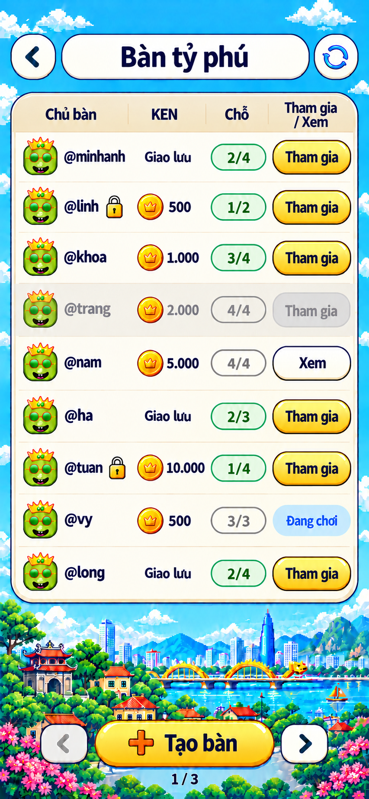

# S3. Danh sách bàn — Bảng giấy kem

**Đã chọn mẫu 01 — Bảng giấy kem** (22/10/2026). Đây là đặc tả style để dựng màn danh sách bàn online theo ảnh bên dưới. Hành vi và dữ liệu theo [02 §S3](../../02-screen-specs.md#s3-danh-sách-bàn-rankedscreen); cột KEN và nút `Xem` theo [11 §1.3](../../11-room-settings.md#13-hiển-thị) và [11 §2.4](../../11-room-settings.md#24-nút-vào-xem-ở-s3). Màn **chưa dựng** trong code.

Ảnh gốc **853 × 1844 px**, giữ nguyên bản được chọn. [Log nguồn và prompt](../../asset-generation-log.md#s3-danh-sách-bàn--bảng-giấy-kem). Ảnh concept không import vào game; chữ, số và avatar luôn là DOM hoặc asset gốc.

## 1. Hướng hình ảnh

- Nền trời cyan có mây pixel, dải phố Việt Nam (Văn Miếu, cầu Rồng, tòa tháp, hoa đào) ở phần dưới, giống hệt lobby S2. Danh sách nằm trong **một bảng giấy kem duy nhất**, viền navy, chia hàng bằng đường kẻ mảnh; không tách mỗi bàn thành thẻ riêng.
- Header gồm ba khối: nút tròn `‹` bên trái, thanh pill kem chứa tiêu đề `Bàn tỷ phú` ở giữa, nút tròn `Làm mới` chỉ có icon bên phải, đối xứng với nút `‹`.
- Footer: nút vàng `+ Tạo bàn` ở giữa, hai nút phân trang tròn hai bên, số trang `1 / 3` bên dưới.
- Một nút vàng nổi bật nhất là `Tạo bàn`; các nút `Tham gia` cũng vàng nhưng nhỏ, nằm trong bảng. `Xem` là nút kem viền navy.
- Pixel chỉ dùng cho phong cảnh; bảng, nút, chip, icon và chữ mượt, viền navy, theo [style chung](../../style/README.md).

## 2. Ảnh là chuẩn cho

- Bố cục: header → bảng 9 hàng → dải phố → footer.
- Bốn cột `Chủ bàn | KEN | Chỗ | Tham gia / Xem`; tiêu đề cột cuối xuống hai dòng.
- Hình thức từng trạng thái hàng (§5): nút vàng, nút mờ, nút kem `Xem`, chip xanh nhạt `Đang chơi`.
- Badge chỗ dạng pill viền xanh ngọc khi còn chỗ, viền xám khi đầy hoặc đang chơi.
- Đồng KEN vàng có vương miện trước số cược; bàn 0 ghi `Giao lưu`, không có đồng.

## 3. Docs thắng ảnh ở

- **Avatar:** ảnh vẽ mặt cười xanh đội vương miện cho mọi chủ bàn. Production dùng icon VIP của từng user ([03 §18](../../03-component-specs.md#18-tên-người-chơi-và-icon-vip-playername-playeravatar)).
- **Dữ liệu:** tên, số KEN, số chỗ, số trang là dữ liệu mẫu; luôn lấy từ `ROOM_LIST`.
- **Chip `Đang chơi`:** ảnh vẽ chữ xanh dương trên nền xanh nhạt, độ tương phản không đạt AA. Dùng chữ `--ty-navy` trên nền `--ty-sky-soft`.
- **Tên cho trình đọc màn hình:** nút `‹` và nút `Làm mới` chỉ có icon; đặt `aria-label` `Quay lại` và `Làm mới danh sách bàn`.

## 4. Bố cục tại 390 × 844

Tọa độ tính trong vùng sau safe-area, quy đổi từ ảnh 853 px theo tỷ lệ 390 / 853. Đây là mốc kiểm bố cục; dựng bằng luồng dọc, khung cao đúng một màn (`height: 100dvh`, không cuộn) như lobby.

| Vùng | Vị trí và kích thước CSS px | Nội dung |
|---|---|---|
| Header | y 36–82 | nút `‹` tròn 46 ở x 12; thanh tiêu đề pill từ x 66 đến 324, cao 46; nút `Làm mới` tròn 46 ở x 332 |
| Bảng | x 12–378, y 98–636 | hàng tiêu đề cột cao 41 + 9 hàng × 55 |
| Dải phố | y 638–760 | trang trí của nền, không nhận pointer events |
| Footer | y 760–812 | `Tạo bàn` 188 × 46 ở giữa; nút trang tròn 48 ở x 43 và x 297 |
| Số trang | y 814–830 | `1 / 3` căn giữa |

Cột trong bảng (rộng 366): `Chủ bàn` 112 · `KEN` 80 · `Chỗ` 62 · cột cuối 88; lề trong 8.

Màn 360: bảng 336, giảm cột `Chủ bàn` trước; tên dài cắt `…`. Màn thấp (< 700): hàng giữ 55, dải phố co lại trước, footer luôn hiện; không bớt hàng. Khung tối đa 520, nền trời phủ ngoài khung như lobby.

## 5. Hàng và trạng thái

| Phần | Thông số |
|---|---|
| Avatar | icon VIP 34, tròn |
| Tên | `@username` 15/700 navy, cắt `…`; bàn khóa có ổ khóa 18 ngay sau tên |
| KEN | đồng KEN 24 + số 15/800 có dấu chấm hàng nghìn; bàn 0 chỉ có chữ `Giao lưu` 14/700 |
| Badge chỗ | pill 58 × 27, chữ 15/800; còn chỗ: viền `--ty-jade` 2, chữ jade; đầy hoặc đang chơi: viền và chữ xám |
| Nút cột cuối | pill 82 × 34, chữ 16/800 |

| Trạng thái bàn | Nền hàng | Cột cuối |
|---|---|---|
| chờ, còn chỗ | giấy kem | `Tham gia` vàng `.ty-btn-gold` |
| chờ, đủ người | xám nhạt, avatar và tên mờ 50% | `Tham gia` xám, disabled |
| đang chơi, cho xem | giấy kem, không mờ | `Xem` kem `.ty-btn-paper` viền navy, hoạt động |
| đang chơi, không cho xem | giấy kem, không mờ | chip `Đang chơi` 13/800, nền `--ty-sky-soft`, không viền, không bấm |

Hàng không bấm được cả hàng; chỉ nút cột cuối nhận thao tác. Nút đang gửi (`ROOM_JOIN` hoặc `SPECTATE_JOIN`) hiện spinner và khóa các nút khác trong bảng.

## 6. Trạng thái ngoài ảnh

Ảnh chỉ có trạng thái có dữ liệu. Các trạng thái sau dựng trong cùng khung bảng:

| Trạng thái | Hiển thị |
|---|---|
| Đang tải lần đầu | 9 hàng khung xám nhạt nhấp nháy nhẹ; reduced motion thì đứng yên |
| Trống | giữa bảng: `Chưa có bàn nào` 17/800 + `Tạo bàn để mời bạn bè cùng chơi` 14; nút `Tạo bàn` ở footer vẫn là hành động chính |
| Lỗi tải | giữa bảng: icon `wifi-off`, `Chưa tải được danh sách bàn`, nút kem `Thử lại` |
| Làm mới | icon trong nút `Làm mới` xoay, bảng giữ dữ liệu cũ |
| Trang đầu / cuối | nút trang tương ứng xám, disabled |

Lỗi khi bấm `Tham gia` / `Xem` báo bằng toast theo [11 §2.4](../../11-room-settings.md#24-nút-vào-xem-ở-s3); thiếu KEN báo bằng O5 `Chưa đủ KEN` ([11 §1.2](../../11-room-settings.md#12-vào-bàn-có-cược)).

## 7. Asset

| Chi tiết | Lớp | Ghi chú |
|---|---|---|
| Nền trời, mây, dải phố | dùng lại `lobby/bg-board-pixel.webp` | cùng cảnh với concept; không cắt asset mới |
| Đồng KEN | dùng lại `lobby/ill-ken.webp` | cùng đồng vàng vương miện |
| Ổ khóa | `ic-lock` 18 | ảnh vẽ ổ khóa vàng; cắt từ concept nếu cần giống hơn |
| Icon `Làm mới`, mũi tên | `ic-refresh`, `ic-chevron-left/right`, `ic-arrow-left` | SVG có sẵn |
| Dấu `+` trong `Tạo bàn` | `ic-plus` | SVG có sẵn |
| Bảng, hàng, nút, badge, chip | CSS | theo token style chung |
| Avatar | icon VIP của user | không lấy mặt cười trong ảnh |

## 8. Checklist triển khai

- [ ] Màn S3 với dữ liệu mock: 9 hàng đủ bốn trạng thái ở §5, khóa, bàn 0 và bàn có cược.
- [ ] Header, bảng, footer đúng §4 ở 390 × 844, 360 × 640, 520 × 900; không cuộn.
- [ ] Trạng thái tải, trống, lỗi, làm mới, trang đầu/cuối (§6).
- [ ] Nút `Xem` và các lỗi khi vào xem theo 11 §2.4.
- [ ] Chụp so với concept; chữ đạt AA; vùng chạm ≥ 44.
