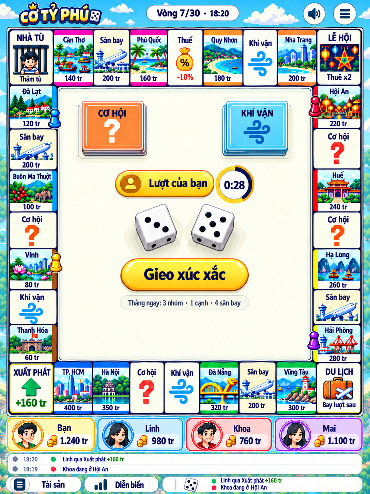

# Ảnh mẫu UI — Cờ Tỷ Phú

[`concept-s6-board-pixel-16bit.png`](./concept-s6-board-pixel-16bit.png) là **ảnh mẫu chuẩn** cho giao diện Cờ Tỷ Phú (UI v3, phong cách **pixel 16-bit**, chốt ngày 20/10/2026). Ảnh tạo bằng AI (built-in imagegen) để tham khảo. Đây không phải asset của game: code không import ảnh này, và không cắt ảnh ra để dùng.

Ảnh thuộc màn **S6. Bàn chơi** (`BoardScreen`, [02 §S6](../02-screen-specs.md)), pha `roll`. Quy ước tên: `concept-s{số màn}-{tên màn}-{style}.png`, ví dụ màn S7 vẽ sau sẽ là `concept-s7-tile-sheet-pixel-16bit.png`.

Docs đã được sửa theo ảnh này: [art direction](../01-art-direction.md), [hệ style](../style/README.md), [bảng 32 ô](../style/02-board-tiles.md), [component](../03-component-specs.md), [màn bàn chơi](../02-screen-specs.md), [asset](../04-asset-manifest-and-prompts.md), [icon](../06-icon-system.md).

## Ảnh mẫu là chuẩn cho

- **Nền màn:** trời xanh, mây và cây pixel ở viền.
- **Ô bàn:** mỗi thành phố một tranh pixel 16-bit; sân bay chung một tranh máy bay; Cơ hội `?` cam, Khí vận gió xanh, Thuế túi tiền `%`; nền ô sáng.
- **Ô góc:** `XUẤT PHÁT` mũi tên xanh lá; `NHÀ TÙ` tranh phòng giam có `Thăm tù`; `LỄ HỘI` nền navy đèn lồng, `Thuê x2`; `DU LỊCH` vali cam, `Bay lượt sau`.
- **Giữa bàn:** chồng thẻ `CƠ HỘI` cam và `KHÍ VẬN` xanh; chip `Lượt của bạn` + đồng hồ; 2 xúc xắc trắng nổi khối; nút vàng `Gieo xúc xắc` hình viên thuốc nổi khối; dòng gợi ý `Thắng ngay`.
- **Quân:** con tốt màu ghế (vàng, xanh, san hô, tím), đứng ở mép trong ô.
- **Header, pod, footer:** logo vàng nổi khối, chip vòng, nút tròn trắng; 4 pod một hàng dưới bàn; pill `Tài sản`, `Diễn biến`.

## Docs vẫn thắng ảnh ở

- **Dữ liệu:** tên ô, thứ tự, giá, tiền thuê, chủ sở hữu, trạng thái lấy từ [`logic/board.json`](../../logic/board.json) và ván chơi; chữ dựng bằng DOM. Tiền trên pod trong ảnh chỉ là số minh họa.
- **Tên và avatar người chơi:** ảnh vẽ tên mẫu (`Linh`, `Khoa`, `Mai`) và mặt người; khi dựng pod người khác ghi `@username`, avatar là icon VIP của user ([03 §18](../03-component-specs.md)).
- **Mã màu nhóm đất và màu ghế:** dùng token trong [`style/01-foundations.md`](../style/01-foundations.md); ảnh vẽ đậm hơn (ví dụ hồng gần magenta).
- **Ba chỗ ảnh tự mâu thuẫn:**
  - bàn hơi cao hơn rộng → khi dựng khóa **1:1**;
  - dải màu hàng trên nằm ở mép ngoài và tên đè lên dải → đặt dải ở **mép trong** như 3 cạnh còn lại, không có chữ trên dải;
  - log xuất hiện ở cả thẻ Diễn biến lẫn footer → chỉ **một vùng log** tại một thời điểm.

Ảnh mẫu chỉ có pha gieo xúc xắc. Các pha mua, mua lại, lễ hội, du lịch, quản lý và nợ dùng chung bố cục này; nội dung giữa bàn theo [đặc tả màn hình](../02-screen-specs.md).
