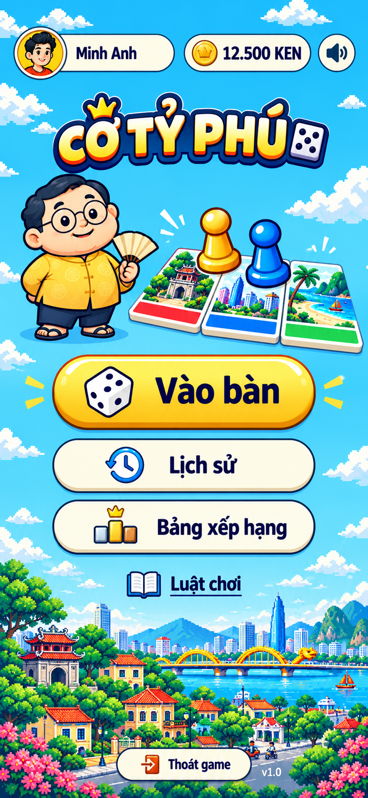

# S2. Lobby — Nền trời thoáng

**Đã chốt phương án 1 — Nền trời thoáng.** Đây là đặc tả style để dựng lại màn lobby theo ảnh bên dưới. Phạm vi của tài liệu là S2; hành vi online theo [02 §S2](../../../02-screen-specs.md#s2-lobby), luật chơi theo [05](../../../05-gameplay-rules-and-protocol.md). UI hiện tại chưa được coi là đã triển khai mẫu này.

Ảnh gốc **853 × 1844 px**, giữ nguyên bản được chọn. [Log nguồn và prompt](../../../asset-generation-log.md). Ảnh concept không import trực tiếp vào game; asset được **cắt từ concept** theo [quy trình asset theo màn](../README.md#quy-trình-asset-theo-màn), PNG gốc ở [`assets/screens/lobby/`](../../../../assets/screens/lobby/README.md), khi code mới xuất WebP/SVG. Chữ (nhãn nút, tên, số KEN, version) không cắt từ ảnh, luôn là DOM text.

**Bộ tách thử đã có theo yêu cầu người dùng:** 13 PNG được lưu theo màn tại [assets/screens/lobby](../../../../assets/screens/lobby/README.md), gồm logo, Bác Tỷ, cụm thẻ/quân, nền, icon và nền nút. Đây là bản tách/inpaint bằng AI để tham khảo, chưa tối ưu hoặc tích hợp runtime; bảng asset production bên dưới vẫn là kế hoạch SVG/WebP.

## 1. Hướng hình ảnh và thứ tự ưu tiên

- Nền trời cyan thoáng, mây pixel ở viền; phố Việt Nam, cây, núi và sông ở phần dưới. Không đặt một panel lớn sau toàn bộ menu.
- Logo vàng viền navy nằm trên hero. Bác Tỷ bên trái; ba thẻ đất giấy kem có tranh pixel, hai quân con tốt vàng/xanh ở bên phải. Hero và logo tách khỏi vùng nút.
- Một nút chính vàng `Vào bàn`, hai nút kem `Lịch sử`, `Bảng xếp hạng`, rồi action chữ có sách `Luật chơi`. Footer có pill `Thoát game` và version.
- Bóng elip dưới chân Bác Tỷ trong ảnh không lấy: nhân vật không đổ bóng ngoài theo [03-characters](../../03-characters.md).
- Pixel chỉ dùng cho phong cảnh. Mascot, quân cờ, thẻ, icon, nút và chữ mượt, contour navy. Ánh sáng nhẹ và mép dưới tạo độ nổi; không thêm glow, glass hay hạt liên tục.
- **Ảnh quyết định mỹ thuật và tương quan bố cục; tài liệu này quyết định kích thước triển khai, responsive và trạng thái.** Palette lấy từ [01-foundations](../../01-foundations.md), không lấy màu mới từ ảnh AI.
- Chữ `Minh Anh`, chân dung người, `12.500 KEN`, `v1.0` trong ảnh là dữ liệu mẫu. Production dùng avatar VIP + `@username` theo [03 §18](../../../03-component-specs.md#18-tên-người-chơi-và-icon-vip-playername-playeravatar), số KEN thật và version của build. Không bake các dữ liệu này vào ảnh.

## 2. Bố cục tại 390 × 844

Tọa độ dưới đây tính trong vùng nội dung **sau khi đã trừ safe-area**, với vùng khả dụng 390 × 844. Đây là mốc kiểm bố cục, không dùng `position: absolute` cho cả màn. Dùng luồng dọc để tên dài, thông báo và màn thấp có thể tăng chiều cao mà không đè nhau.

| Vùng | Vị trí và kích thước CSS px | Nội dung |
|---|---|---|
| Topbar | x 12, y 28, rộng 366, cao 52 | profile pill, KEN pill, âm thanh |
| Logo | giữa ngang, y 100, khung tối đa 320 × 80 | logo `CỜ TỶ PHÚ`, crown và một viên xúc xắc nằm trong logo |
| Hero | x 12, y 188, rộng 366, cao 176 | Bác Tỷ trái; ba thẻ + hai quân bên phải |
| Menu | giữa ngang, y 376–648, rộng 280 | cao lần lượt 80 / 56 / 56 / 44; gap 12 |
| Cảnh phố dưới | chủ yếu từ y 648 đến đáy | trang trí, không nhận pointer events |
| Footer | giữa ngang, y 780–824; cách đáy 20 | nút thoát cao 44 + version, gap 10 |

Các khoảng dọc chuẩn: topbar → logo 20; logo → hero 8; hero → menu 12. Footer dùng `margin-block-start: auto`, cách menu ít nhất 24. Tránh neo footer bằng `position: fixed` khiến nó che menu trên điện thoại thấp.

Khung lobby tối đa 520 px, căn giữa màn; nền trời tiếp tục phủ ngoài khung ở desktop. Topbar/hero có lề ngang 12. Menu dùng `inline-size: clamp(256px, calc(80% - 32px), 320px)` theo chiều rộng vùng khả dụng: 280 px tại 390, 256 px tại 360, tối đa 320 px tại 520. Logo tối đa 320 px, không kéo giãn sai tỷ lệ.

## 3. Chữ và màu

Font production là **Nunito**, tái dùng hai file đang được khai báo trong [style.css](../../../../style.css): `Nunito-400-800-latin.woff2` và `Nunito-400-800-vietnamese.woff2` từ Caro. Chữ trong ảnh AI chỉ gần với Nunito, không phải mẫu font để trích xuất. Không tải thêm font từ CDN; logo là artwork riêng, không dựng bằng font nội dung.

| Thành phần | Font size / weight / line-height |
|---|---|
| `@username` | 16 / 800 / 1.2 |
| Số dư KEN | 17 / 800 / 1.2, `tabular-nums` |
| `Vào bàn` | 32 / 800 / 1.15 |
| `Lịch sử`, `Bảng xếp hạng` | 24 / 800 / 1.2 |
| `Luật chơi` | 22 / 800 / 1.2, underline offset 4 |
| `Thoát game` | 16 / 800 / 1.2 |
| Version | 12.5 / 700 / 1.35 |
| Trợ giúp/lỗi | 13.5 / 600 / 1.35 |

Chữ và contour dùng navy `#1F2A44`; paper `#FCFDF0`, mép paper `#F0E4C8`; CTA gradient gold `#FFD34D → #F2B807`, mép dưới `#B98700`. Nền trời `#35C1FC → #7FE3F7`; màu tiền/trạng thái hợp lệ jade `#1F8A5B`, lỗi/thoát coral `#E4573D`. Không đổi toàn bộ KEN thành gold: số dư vẫn navy để đọc rõ trên nền kem.

Version dùng chữ navy trên nền paper nhỏ, không dùng chữ trắng trực tiếp trên cảnh phố nhiều chi tiết như ảnh. Các nhãn phải giữ đủ dấu tiếng Việt và đọc được tại 360 px.

## 4. Topbar và dữ liệu

- **Profile:** pill paper, viền navy 1.5; avatar VIP 44 × 44 bên trái, gap 6, tên `@username` ở phải. Ở lobby vẫn hiện username của chính mình, không đổi thành `Bạn`. Không gắn thêm badge VIP thứ hai, không dùng chân dung mẫu trong ảnh.
- **Tên dài:** phần tên có `min-width: 0`, cắt ellipsis theo chiều rộng còn lại; giới hạn tối đa 16 ký tự sau `@` theo quy ước list. Accessible name giữ đầy đủ tên. Không cắt chuỗi rồi dùng chuỗi đã cắt cho dữ liệu/aria-label.
- **KEN:** pill paper cùng cao topbar, `ic-ken` 24 + số dư đã format + hậu tố `KEN`. Không cho đổi số làm dịch nút âm thanh ra ngoài khung. Không dùng ellipsis hoặc tự làm tròn số dư thành K/M.
- **Âm thanh:** vùng chạm 44 × 44, căn giữa dọc; hình tròn paper viền navy 1.5, `ic-volume-on/off` 24. `aria-pressed` phản ánh bật/tắt; tên truy cập là hành động `Tắt âm` hoặc `Bật âm`.
- Hàng chuẩn dùng grid `minmax(0, 1fr) max-content 44px`, gap 8. Nếu số KEN không còn đủ chỗ cùng profile tối thiểu 108 px, chuyển KEN xuống hàng 2 hết chiều rộng, profile và loa ở hàng 1. Topbar tăng cao trong luồng; logo và menu dịch xuống theo, không chồng nhau.
- Chưa có dữ liệu user: skeleton đúng footprint, số dư chưa biết hiện `— KEN`, không giả thành `0 KEN` và không hiển thị mẫu `Minh Anh`. Lỗi tải hiển thị thông báo và action thử lại theo §8.

## 5. Hero và asset

Hero là một nhóm trang trí `aria-hidden="true"`, `pointer-events: none`; không phải bàn có thể chơi hoặc chọn ô.

| Lớp | Quy cách |
|---|---|
| Nền | Dùng chung `lobby/bg-board-pixel.webp`; mây ở rìa, trời trống sau logo/menu, phố neo đáy. Khi crop ưu tiên giữ cảnh phố và không kéo méo pixel. Không cần nền lobby mới. |
| Logo | `lobby/logo.webp`, transparent, contain trong khung 320 × 80. Tên game được cung cấp một lần bằng heading/accessible name. |
| Bác Tỷ | `chars/ty-idle-full.webp`, hình nhìn thấy cao 176, rộng khoảng 140; căn trái và đáy hero. Áo bà ba gold, quần navy, kính tròn, quạt giấy mở nhẹ như mẫu, nụ cười thân thiện. |
| Ba thẻ đất | Nhóm bên phải rộng khoảng 224, cao 132; ba thẻ xếp xòe nhẹ, có khoảng chồng, dải màu nằm dưới, contour navy và mép paper. Vẽ khung bằng SVG/CSS, không chữ/giá/quyền sở hữu. |
| Tranh trong thẻ | Tái dùng ba tranh trong `tiles/art`: Hội An, TP. Hồ Chí Minh, Đà Nẵng. Lấy màu nhóm tương ứng từ dữ liệu bàn (đỏ, xanh dương, xanh lá); cảnh trong ảnh là minh họa, không buộc sao chép địa danh sai màu nhóm. |
| Hai quân | Dùng hình con tốt `tk-pawn.svg`, gold và blue theo màu ghế, cao khoảng 64/58, đứng trước hai thẻ. Không dùng avatar làm quân trong hero. |

Thứ tự lớp: nền → thẻ → quân → mascot; mascot và cụm thẻ có thể chồng mép tối đa 8 px, không che mặt, quân hoặc logo. Khung 256 × 256 của mascot là canvas xuất file: trim vùng trong suốt khi đặt layout để **hình nhân vật**, không phải canvas vuông, đạt chiều cao 176.

Nếu tắt nhân vật hoặc asset nhân vật chưa tải, giữ footprint hero và thay bằng glyph crown/coin gọn; CTA vẫn nằm đúng chỗ. Asset decor lỗi không được khóa navigation hoặc lặp tải vô hạn. Phong cảnh pixel export theo bội số nguyên, không filter làm mịn; UI và mascot vẫn mượt.

## 6. Nút và minh họa

Kích thước/font ở đây là biến thể **riêng S2**, không đổi nút trong bàn S6 hoặc modal. Nội dung icon + nhãn căn giữa như một nhóm, gap 10–12; không dành một cột icon riêng làm nhãn lệch tâm. Nhãn luôn là DOM text.

| Action | Surface và kích thước | Minh họa | Hành vi |
|---|---|---|---|
| `Vào bàn` | gold, cao 80, pill, viền 2 gold-deep, mép dưới 4 | xúc xắc trắng/navy 48 | `openRanked()` → S3; preload RANKED |
| `Lịch sử` | paper, cao 56, pill, viền navy 1.5, mép dưới 3 paper-dim | đồng hồ/mũi tên blue 40 | mở S10 |
| `Bảng xếp hạng` | paper, cao 56, pill như trên | bục gold, blue, coral + crown, 40 | mở S11 |
| `Luật chơi` | trong suốt, cao 44, chữ navy gạch chân | sách paper/navy, 32 | modal luật có thể cuộn, nút Đóng; dùng offline |
| `Thoát game` | paper, cao 44, pill; rộng theo nội dung, padding ngang 18 | cửa/mũi tên coral, 24 | `bridge.exit()` |

Các hình trong nút là **5 minh họa trang trí** `lobby/ill-{dice,history,leaderboard,rules,exit}`. Nguồn hiện tại là PNG cắt từ concept (`icon-*.png`, §10); khi code xuất WebP, hoặc vẽ lại SVG viewBox 48 × 48 nếu cần nét sắc. Contour navy, hình khối đơn giản, 2–3 màu và highlight nhỏ; không chữ, emoji. Chúng không thay hệ 30 icon `ic-*` dùng cho điều khiển chung. Màu và hình cần giữ cùng nét với ảnh mẫu.

Minh họa có `aria-hidden`, tên action chỉ đọc nhãn nút. Khi chưa có minh họa: dùng `ic-dice/history/leaderboard/exit-door`; `Luật chơi` có thể tạm chỉ có chữ, giữ slot và khoảng cách ổn định. Fallback này không phải trạng thái đạt visual QA cuối.

`Vào bàn` là nút gold duy nhất của S2. `Luật chơi` mở modal trên backdrop và khóa tương tác nền; nút Đóng dùng paper. Không gắn badge, đếm người online, quảng cáo, hàng tab hay CTA mới vào bố cục đã chọn.

## 7. Trạng thái và chuyển động

| Trạng thái | Biểu hiện |
|---|---|
| Default | Theo bảng §6, label không bị che bởi highlight/mascot |
| Hover (thiết bị có hover) | Sáng nhẹ, dịch lên 1 px; không scale làm thay đổi vùng chạm |
| Pressed | Dịch xuống 2 px, giảm mép nổi tương ứng; không đổi kích thước layout |
| Focus-visible | Ring navy 2 px, cách 3 px có nền paper ngăn với nút; không chỉ đổi màu vàng trên nút vàng |
| Disabled | `disabled` thật, opacity 45%, không hover/press; có lý do trạng thái bằng text ngoài nút |
| Pending | Spinner thay hình trong slot cũ, giữ nhãn/chiều rộng, `aria-busy`; chặn gửi lặp action |
| Lỗi action | Toast tiếng Việt có thể đọc bằng `aria-live`, phục hồi nút khi kết thúc request; không thay label thành mã lỗi |

Menu vào màn: fade + translateY 6 px, 180–220 ms, stagger tối đa 30 ms. Không lắc/nhấp nháy CTA lặp vô hạn; mây/phố mặc định đứng yên. Bác Tỷ chỉ bob nhẹ ở tier Full theo [08 §U2](../../../08-fx-and-animation.md), tier Lite/Off đứng yên. Chọn tier trong menu tùy chọn S6, không thêm control cạnh loa trong S2. `prefers-reduced-motion` tắt translate/stagger và decor motion; focus, pending và error vẫn rõ bằng trạng thái tĩnh.

## 8. Loading, offline và responsive

S1 là trạng thái của cùng `LobbyScreen`, không dựng đồng thời hai logo hoặc hai menu. Loading/connecting dùng bố cục S1; sau `ready` chuyển sang S2. `LOBBY_CRITICAL` và budget theo [04 §5](../../../04-asset-manifest-and-prompts.md#5-preload-groups-assetsts); PNG concept 2 MB trong docs không tham gia tải game.

Khi mất kết nối trong S2, giữ các khối đã hiển thị; ba action online (`Vào bàn`, `Lịch sử`, `Bảng xếp hạng`) disabled, thêm dòng lý do và action `Thử lại` paper trong luồng. `Luật chơi`, âm thanh và thoát vẫn dùng được. S1 error dùng CTA thử lại theo 02; không hiển thị đồng thời CTA thử lại S1 và menu S2. Bản client-only hiện có giữ luồng chơi máy cho đến khi triển khai online; nhãn `Vào bàn` trong đặc tả không có nghĩa S3 đã tồn tại.

| Vùng khả dụng | Quy tắc |
|---|---|
| 390 × 844 | Bám mốc §2, tất cả control nhìn thấy, phố ở phần đáy |
| Rộng 360 | Menu 256; secondary text có thể giảm xuống 22; logo tối đa `W − 48`; hero giảm đều theo chiều rộng. Topbar dùng quy tắc xuống hàng §4 nếu cần. Không cắt `Bảng xếp hạng`. |
| Rộng 520 | Menu tối đa 320; logo tối đa 320; hero tối đa 400, căn giữa. Thêm khoảng trời hai bên, không phóng font theo viewport. |
| Cao < 760 | Lề trên 16, logo cao 72, hero cao tối đa 144, CTA chính 64 / chữ 28, secondary 52 / chữ 22; gap menu giữ 12. Footer vẫn cao 44, có thể nằm dưới fold. |
| Cao < 680 hoặc font phóng lớn | Cho toàn màn cuộn dọc; giảm decor trước, không ép text, ẩn action hoặc đặt footer đè nội dung. Nút có `min-height`, cho tăng chiều cao theo chữ. |
| Cao > 900 | Giữ kích thước control, thêm khoảng trời giữa menu và footer; cảnh phố neo đáy |

Safe-area: dùng cùng cơ chế host của game (`data-ola-native-safe-area`); WebView đã inset thì không cộng `env(safe-area-inset-*)` lần hai. Trong browser tự inset, trừ inset trước khi tính W/H. Màn thấp phải scroll tới nút thoát bằng touch và bàn phím; tránh `overflow: hidden` trên vùng chứa toàn menu.

## 9. Checklist triển khai và kiểm ảnh

Các mục dưới đây là **việc triển khai tiếp theo**, không đánh dấu hoàn thành chỉ vì đã có concept/docs.

- [ ] Dựng DOM/CSS theo vùng §2, font Nunito với glyph tiếng Việt; dùng `PlayerAvatar`/`PlayerName` theo quy tắc danh tính.
- [ ] PNG gốc cắt từ concept đã qua QA (§10); khi code xuất WebP/SVG theo tên production ở §10, đạt budget; không import trực tiếp concept hoặc PNG gốc.
- [ ] Nối action vào luồng được triển khai; phân biệt S1, S2 ready, pending, lỗi và offline.
- [ ] Chụp 390 × 844 đối chiếu concept: nền mở, logo, mascot trái, 3 thẻ/2 quân phải, menu vàng–kem–kem–text, footer; không mất hoặc thêm action.
- [ ] Chụp 360 × 640, 390 × 844 có safe-area, 520 × 900; thử username dài 24 ký tự, KEN 19 chữ số, user không VIP, zoom text 200%, reduced-motion, asset lỗi.
- [ ] Kiểm tên/VIP/số KEN/version đều là dữ liệu thật, không có placeholder ảnh lọt vào trạng thái ready.
- [ ] Tab theo thứ tự âm thanh → Vào bàn → Lịch sử → Bảng xếp hạng → Luật chơi → Thoát; modal quản lý focus và trả focus về nút mở.
- [ ] Nút không dưới vùng chạm 44 × 44; kiểm contrast và overflow, budget tải lobby ≤ 180 KB gzip; typecheck và kiểm tương tác sau khi có code UI.

## 10. Asset cắt từ concept → file production

PNG gốc nằm ở [`assets/screens/lobby/`](../../../../assets/screens/lobby/README.md). Khi code S2 mới xuất sang file runtime dưới đây; trước đó giữ PNG.

| PNG gốc | File runtime khi code | Ghi chú QA trước khi xuất |
|---|---|---|
| `background.png` | `lobby/bg-board-pixel.webp` (nền trời dùng chung) | pixel đang mờ/nhòe: dọn lại trên lưới pixel, phóng nearest-neighbor theo bội số nguyên |
| `logo.png` | `lobby/logo.webp` | — |
| `mascot.png` | `chars/ty-idle-full.webp` | áo có hoa văn và đổ chuyển màu: làm phẳng 2–3 màu theo [03-characters](../../03-characters.md) |
| `hero-properties.png` | `lobby/hero-properties.webp` | 3 thẻ + 2 quân đang gộp một lớp; tách riêng nếu cần animate quân |
| `icon-dice.png`, `icon-history.png`, `icon-leaderboard.png`, `icon-rules.png`, `icon-exit.png` | `lobby/ill-{dice,history,leaderboard,rules,exit}.webp` (hoặc `.svg` nếu vẽ lại vector) | `icon-exit`: mũi tên đang chỉ vào cửa, nên đổi chỉ ra ngoài |
| `icon-ken.png` | `lobby/ill-ken.webp` | chỉ dùng trong pill KEN của S2; `ic-ken` vẫn dùng ở chỗ khác |
| `icon-sound.png` | `lobby/ill-sound-on.webp` | thiếu trạng thái tắt: cắt/vẽ thêm `icon-sound-off.png` trước khi code |
| `button-gold.png`, `button-paper.png` | không xuất | nút vẫn dựng bằng CSS (§6) để co giãn và có đủ trạng thái; PNG chỉ để so màu/khối khi QA |
